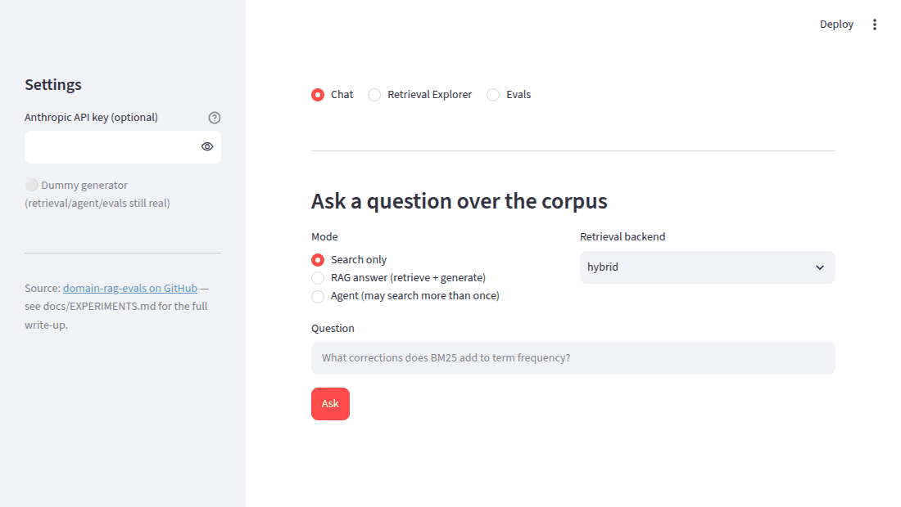

# Domain RAG & Evals

**A question-answering system that looks things up before it answers.**

Ask it a question and it searches a document corpus first, retrieves what's
relevant, and writes a cited answer — instead of guessing from memory. It's the
same core idea behind support bots that answer from a company's docs, or coding
assistants that consult documentation before replying.

Everything below is measured, not asserted: real retrieval, real generation
(Anthropic Claude), a tool-calling agent, a learned reranker, and evals with
real numbers — see [docs/EXPERIMENTS.md](docs/EXPERIMENTS.md) for every result
computed end to end, with reproduction commands.

## Try it

No hosted demo is live right now (that needs a Streamlit Community Cloud
account to deploy to, which isn't something a repo can carry for you) - but
you can deploy your own in one click:
**[Deploy to Streamlit Community Cloud](https://share.streamlit.io/deploy?repository=Tahseen-gh/rag-agent-evals&branch=main&mainModule=ui/app.py)**.
Once deployed: ask a question, compare retrieval backends side by side, and
see the eval numbers computed live in your browser. No API key needed by
default (retrieval, the agent loop, and evals are all fully real either way;
only the final generation step is a deterministic stand-in unless you paste
your own key into the sidebar for that session).



Run it locally: `pip install -r requirements.txt && streamlit run ui/app.py`

## How it works

1. **A knowledge base.** 24 documents on AI / retrieval / agent concepts,
   hand-written for this project, sit in a searchable corpus (`data/corpus/`).
2. **Search.** An incoming question is matched against the corpus four
   different ways: plain keyword matching, meaning-based semantic search, a
   blend of the two, and a version where a small trained model *learned* the
   best blend instead of a human guessing it.
3. **Answer generation.** The retrieved documents are passed to Claude, which
   writes an answer with citations back to the specific source — so you can
   check where a claim came from instead of taking it on trust.
4. **Agent mode.** Rather than a single search-then-answer pass, the model can
   decide for itself to search again when the first result wasn't enough — like
   a research assistant that keeps digging until it's satisfied, then stops.
5. **Evals.** The part most demo projects skip. Each search method and each
   generated answer has real accuracy and quality numbers attached, so you can
   see which approach is actually better and by how much.

## Why it exists

As a working system, this is the architecture behind "ask questions about our
internal docs / product / codebase" tools. As a portfolio piece, it's here to
demonstrate the day-to-day work of an AI engineer: not just calling an LLM API,
but building the retrieval pipeline around it, wiring up an agent, and proving
with numbers that the thing works.

## What's in it

- **FastAPI** service: retrieval (`bm25`/`embed`/`hybrid`/`learned` backends),
  cited RAG answers, a tool-calling agent, health/readiness
- **Streamlit UI** (`ui/`): chat over the corpus, a retrieval backend
  comparison view, and a live evals dashboard - see "Try it" above
- Project layout: `fastapi_app/` (API), `rag/` (retrieval, generation, agent),
  `evals/` (datasets & scoring), `ml/` (learned reranker), `ui/` (Streamlit UI)
- Tooling: Docker, docker-compose, Makefile, pre-commit
  (black/ruff/bandit/mypy), GitHub Actions CI
- Tests: pytest, 60+ tests, coverage-gated in CI

Every generation and agent code path is real (it uses the `anthropic` SDK when
`ANTHROPIC_API_KEY` is set), but defaults to a deterministic, dependency-free
fallback (`USE_DUMMY_LLM=true`) so tests and CI never require a network call or
an API key.

## Quickstart

With the Makefile:

```bash
make install        # create venv + install deps
make dev            # run FastAPI with reload (http://127.0.0.1:8000/api/v1/health)
make test           # run tests
make lint           # ruff
make format         # black + ruff --fix
make up             # docker compose up (prod-like)
```

Or step by step:

```bash
# 1) Create and activate a venv (Windows PowerShell)
python -m venv .venv
. .venv/Scripts/Activate.ps1

# 2) Install
python -m pip install -r requirements.txt -r requirements-dev.txt

# 3) Run the API (hot reload for dev)
uvicorn fastapi_app.app.main:app --reload

# 3b) ...or run the Streamlit UI instead (see "Try it" above)
streamlit run ui/app.py

# 4) Check health
curl -s http://127.0.0.1:8000/api/v1/health
# If the API key is enabled:
# export API_KEY=change-me
# curl -H "X-API-KEY: $API_KEY" http://127.0.0.1:8000/api/v1/health

# 5) Tests (coverage gate from pytest.ini)
pytest -q

# 6) Pre-commit hooks
pre-commit run --all-files
```

The Docker image (`make up` / `docker compose up`) runs the FastAPI service
only; the Streamlit UI isn't containerized separately - run it with the
`streamlit run` command above, or deploy it directly to Streamlit Community
Cloud as described in "Try it".

## Structure

```
fastapi_app/      # API app (FastAPI): search, rag/answer, agent/ask, health/ready
rag/              # retrieval backends, ingestion, chunking, generation, agent, llm client
evals/            # eval datasets & runners (retrieval metrics + generation scoring)
ml/               # learned reranker: training, evaluation, persisted weights
ui/               # Streamlit UI: chat, retrieval explorer, live evals dashboard
```

## Retrieval backends

Query the real 24-document corpus (`data/corpus/`) via
`/api/v1/search?q=...&backend=bm25|embed|hybrid|learned&k=5`.

- `bm25` — lexical (rank_bm25)
- `embed` — dense (sentence-transformers, or a deterministic hash-based dummy
  model when `USE_DUMMY_EMBEDDINGS=true`)
- `hybrid` — min-max-normalized score fusion,
  `score = (1 - alpha) * bm25_norm + alpha * embed_norm`
- `learned` — the same fusion, but with weights learned by logistic regression
  (`ml/reranker.py`) instead of a hand-picked `alpha`

Real numbers for all four, and why `learned` outperforms fixed-alpha fusion, are
in [docs/EXPERIMENTS.md](docs/EXPERIMENTS.md#1-retrieval-backend-comparison).

Environment knobs:

- `EMBEDDING_MODEL` (default `sentence-transformers/all-MiniLM-L6-v2`)
- `HYBRID_ALPHA` (weight for embeddings, default `0.5`)
- `USE_DUMMY_EMBEDDINGS` (set `true` to avoid network calls in tests)

## RAG generation & agent

`POST /api/v1/rag/answer` — retrieve, select the most relevant chunk from each
result, and generate a cited answer:

```bash
curl -X POST localhost:8000/api/v1/rag/answer \
  -H 'content-type: application/json' \
  -d '{"question": "What corrections does BM25 add to term frequency?", "backend": "bm25", "k": 4}'
```

`POST /api/v1/agent/ask` — a tool-calling agent loop: the model decides whether
to call a `search_corpus` tool (possibly more than once) before answering,
capped at `AGENT_MAX_TURNS` turns:

```bash
curl -X POST localhost:8000/api/v1/agent/ask \
  -H 'content-type: application/json' \
  -d '{"question": "What is BM25?", "backend": "bm25"}'
```

Both endpoints use a real `anthropic` SDK client when `ANTHROPIC_API_KEY` is set
and `USE_DUMMY_LLM=false`; otherwise they fall back to a deterministic,
dependency-free client (an extractive answerer for `/rag/answer`, a scripted
one-tool-call responder for `/agent/ask`) so the full pipeline is testable
without a key. See
[docs/EXPERIMENTS.md](docs/EXPERIMENTS.md#4-end-to-end-generation-eval) for real
end-to-end numbers.

Environment knobs:

- `EVAL_ANTHROPIC_API_KEY` or `ANTHROPIC_API_KEY` (unset by default → dummy
  mode; the former takes priority - see `fastapi_app/app/config.py` for why)
- `LLM_MODEL` (default `claude-sonnet-5`)
- `USE_DUMMY_LLM` (default `true`)
- `AGENT_MAX_TURNS` (default `6`)
- `RAG_TOP_K` (default `4`)

## Evaluation & CI gates

Retrieval quality is measured on the real corpus with Recall@1/3/5/10, MRR, and
NDCG@10. The `Retrieval evals (quality gates)` workflow runs `bm25`, `embed`,
and `hybrid` and **hard-gates only on `bm25`** against `evals/baseline.json`
(failing if `recall@3`, `MRR`, or `NDCG@10` drop by more than
`ALLOWED_REGRESSION_DELTA`, default `0.01`). `embed`/`hybrid` are reported but
not gated, since they depend on downloading a model from Hugging Face — a
network dependency a hard CI gate shouldn't be able to flake on; `bm25` needs
nothing beyond what's already installed. Real current metrics for every backend
are in
[docs/EXPERIMENTS.md](docs/EXPERIMENTS.md#1-retrieval-backend-comparison).

Generation quality is scored separately: `python -m evals.run --backend hybrid`
runs the real RAG pipeline against `evals/dataset/qas.jsonl` and grades each
answer with a deterministic heuristic judge (keyword coverage + citation
correctness), or with a real LLM judge via `--llm-judge` and `ANTHROPIC_API_KEY`
set.

To intentionally update the retrieval baseline:

```bash
python scripts/eval_retrieval.py --backend bm25 --seed 1337
python scripts/update_baseline.py --from evals/reports/bm25-<git_sha>.json
```

The corpus is pinned via `data/manifest.json`; hashes are checked in tests for
determinism.

## Security

- **Bandit** runs in **pre-commit** and in CI (job **security / bandit**). The
  CI job is **blocking** for MEDIUM/HIGH severity & confidence findings.
- **pip-audit** runs in CI (job **security / pip-audit**) and currently **does
  not block**. We'll flip it to blocking after triage.
- **Dependabot** is enabled for `pip` (grouped runtime/dev) and **GitHub
  Actions** (grouped), with weekly updates and auto-rebase. Look for labels
  `dependencies` and `security`.

**Suppressing Bandit**: if you truly must waive a finding, add an inline
`# nosec` and link a justification in the PR. Avoid blanket suppressions.

**Local checks**:

```bash
pre-commit run --all-files
bandit -r fastapi_app rag ml evals scripts ui -x tests,__pycache__ --severity-level medium --confidence-level medium
pip-audit -r requirements.txt
```

## Operations

- **Readiness**: `GET /api/v1/ready` returns
  `{ "ready": true, "version": "<v>", "git_sha": "<sha>" }`.
- **Correlation IDs**: requests accept and echo an `X-Request-ID` header
  (configurable) and include `request_id` in Problem Details.
- **JSON logs**: one line per request, e.g.:

```json
{"ts":"2024-01-01T00:00:00Z","level":"info","logger":"access","request_id":"...","method":"GET","path":"/api/v1/ready","status":200,"duration_ms":1.2,"client_ip":"127.0.0.1","user_agent":"curl"}
```
